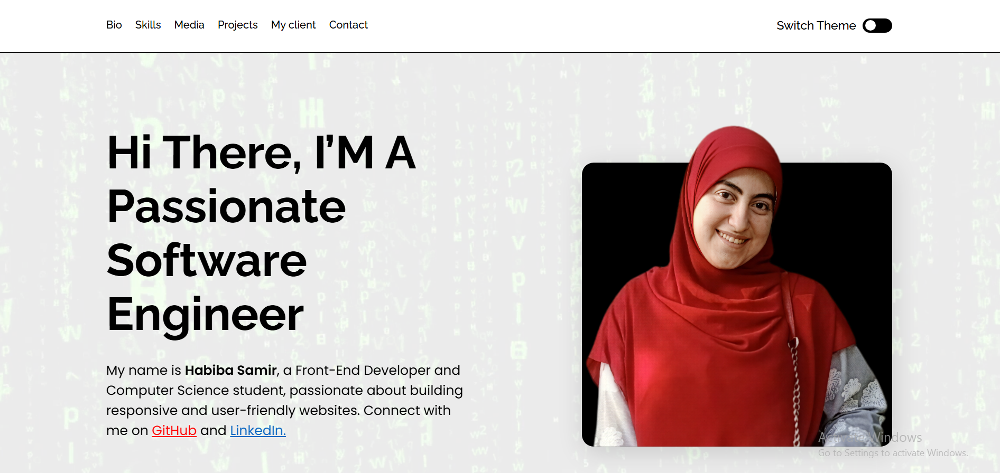

# ✨ Personal Portfolio Website

A modern and responsive personal portfolio website built to showcase my skills, projects, and journey as a frontend developer.

This project was developed as a challenge from **Frontend Mentor**, focusing on responsive layouts, clean code, and modular styling.

## 🌐 Live Demo

[View Live Website](https://habibasamir55.github.io/personal-website/)

## 📸 Preview



## 🛠️ Built With

- HTML5
- CSS3
- Flexbox
- CSS Grid
- Sass (SCSS)
- Modular SCSS Architecture

## ✨ Features

- Fully responsive design.
- Clean and modern user interface.
- Flexible layouts using Flexbox and CSS Grid.
- Organized and maintainable stylesheets using Sass modules.
- Responsive navigation and interactive elements.

## 📂 Project Structure

```text
personal-website/
│
├── brand/
├── components/
├── images/
├── styles/
│
├── index.html
├── results.html
├── style.scss
├── resume.pdf
├── GrillTown_Showcase.mp4
├── video-loop.mp4
└── README.md
```

## 📚 What I Learned

- Building responsive websites using HTML and CSS.
- Creating layouts with Flexbox and CSS Grid.
- Using Sass to write organized and maintainable styles.
- Structuring SCSS code into reusable modules.
- Improving responsive design across different screen sizes.

## 🎯 Challenge

This project was built as part of a challenge from [Frontend Mentor](https://www.frontendmentor.io/).

## 👩‍💻 Author

**Habiba Samir**

- GitHub: [@habibasamir55](https://github.com/habibasamir55)
- Portfolio: [Personal Website](https://habibasamir55.github.io/personal-website/)

---

⭐ If you like this project, feel free to explore the repository!

- GitHub: [@habibasamir55](https://github.com/habibasamir55)
